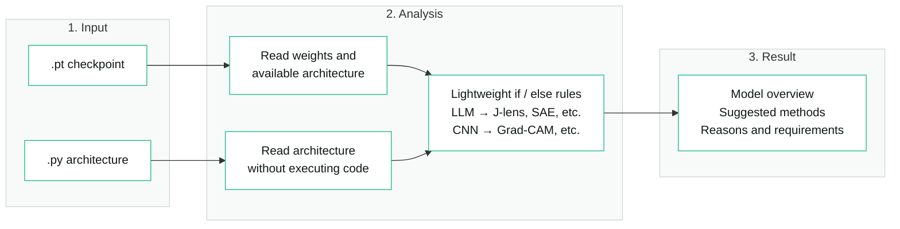

# MockExplain — User stories and usage

- **The idea, in my words**
  - “Many of the insights can be extracted from simply looking at model weights and architecture.”
  - “Like naively, LLM => use J-lens, SAE, etc. CNN => use Grad-CAM, etc.”
  - “Think of this as a meta study in a software form.”
  - “I want a lightweight heuristic if else if possible.”
  - “The user doesn't need to input their prompt at all.”

- **As a user uploading a new model, I want MockExplain to tell me what I am looking at.**
  - I upload a checkpoint or a model folder containing its weights and architecture/configuration.
  - There is a option to upload simply the python file of model architecture for analysis.
  - MockExplain reads the available architecture and tensor information and gives me a model overview.
  - I do not have to type a prompt, describe my task, choose a research question, or supply example inputs to receive insights and suggestions.
  - If a bare checkpoint does not identify its architecture, MockExplain shows what it can read and lets me attach the configuration. It keeps unknown information visible.

- **As a user, I want useful insights from the weights and architecture themselves.**
  - Show the model family, layer structure, tensor shapes, parameter count, dtype, and storage size when these can be established.
  - Point out structures such as convolution kernels, attention blocks, embeddings, output heads, and normalization layers when the available information supports them.
  - Show simple weight statistics, such as value ranges or the proportion of zeros, when a cheap inspection is possible.
  - Read tensor metadata first. Use bounded CPU samples for weight statistics and label sampled results. Do not require a full weight scan or a loaded execution model.
  - Tell me which facts came directly from the checkpoint, which are inferred from its structure, and which information is missing.

- **As a user, I want a lightweight heuristic to suggest which interpretability methods make sense for my model.**
  - If it is an LLM, suggest methods such as J-lens, SAE, vocabulary readouts, or activation analysis, depending on its structure and the method's requirements.
  - If it is a CNN, suggest methods such as Grad-CAM or convolution-filter inspection, depending on its structure and the method's requirements.
  - If it has both convolutional and transformer components, suggest methods for the relevant components.
  - If the model does not match a known case, show the structural facts that are available and say that a method recommendation is not yet covered.
  - Use a small, curated `if` / `elif` rule set. The same inspected information and rule version should give the same suggestions.
  - Start with a few short suggestions and direct links to papers or other sources. I can click for the reason, requirements, and limitations.

- **As a user, I want this to feel like a meta study in a software form.**
  - Bring together what existing research says about interpreting models with these structures.
  - For each suggested method, explain what it helps investigate, why it is relevant here, what it requires, and what its limitations are.
  - Link the suggestion to its paper, documentation, or implementation.
  - For example, an LLM may be a candidate for [J-lens](https://github.com/anthropics/jacobian-lens), but using it requires a compatible fitted lens or a fitting step.
  - A CNN may be a candidate for [Grad-CAM](https://arxiv.org/abs/1610.02391), but producing a heatmap requires an input, a target output, suitable feature maps, and gradients.
  - SAE and NLA suggestions explain the need for compatible trained artifacts or additional training.
  - I can receive these recommendations without running the methods or supplying the inputs they would need for an experiment.
  - Show the distinction between a structural fact, a method recommendation, and a result measured by running that method. A recommendation does not establish what a particular neuron means.

- **As a user opening the app, I want a simple upload-and-read experience.**
  - The main action is uploading or selecting a model.
  - Use two main cards: **1. Model overview** and **2. Suggested methods**.
  - Keep checkpoint switching in the header. Keep the overview and recommendations readable, with details available by clicking.
  - Keep the Unsloth Studio Light Theme: sage-white background `#F7FAF8`, white cards `#FFFFFF`, emerald controls `#10B981`, and dark text `#111815`.
  - I should not land on a prompt box, token-inspection exercise, steering form, or research-question wizard.
  - A labeled example model can demonstrate the experience before I upload anything. Its example information must not be presented as findings about my checkpoint.

- **As a user working with many checkpoints, I want the suggestions to follow the model I uploaded.**
  - Uploading another checkpoint produces its own overview and method recommendations.
  - I can save a report containing the inspected facts, suggested methods, reasons, references, and any missing information.
  - I can compare saved model profiles without rerunning an interpretability experiment.
  - Reports identify the checkpoint, inspection coverage, and rule version. Results from a previous model must not be silently attached to the new one.

- **As a user, this is the usage I expect.**
  - Upload an LLM checkpoint: see its readable structure and weight summary, then suggestions such as J-lens or SAE with their reasons and requirements.
  - Upload a CNN checkpoint: see its readable structure and weight summary, then suggestions such as Grad-CAM with their reasons and requirements.
  - Upload an unfamiliar or incomplete checkpoint: see what MockExplain could inspect and what information is still needed.
  - Get useful guidance from the model itself, without entering a prompt or spending big compute on discovery.

- **Project name and current state**
  - The project and repository are named **MockExplain**.
  - This specification replaces the earlier prompt-driven advisor and automatic-discovery specifications.
  - The old prompt-based prototype has been retired. MockExplain v0.1 now implements bounded model readers, versioned heuristic rules, and the upload-only interface described here; see README.md for supported formats, validation, and limitations.

## Backend

block 1: input
block 2: analysis:
if input is .pt then read both architecture and weight and match to our heuristic
if input is .py architecture only then read arch and match our heuristic
block 3: return result.

### Simple architecture

